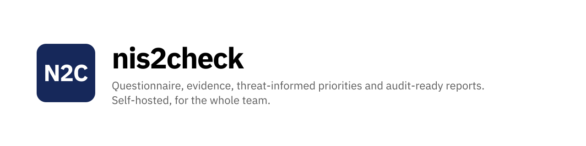

<picture>
  <source media="(prefers-color-scheme: dark)" srcset="docs/brand/banner-dark.svg">
  
</picture>

**Self-hosted NIS2 and DORA gap assessment for the whole team: questionnaire, evidence, threat-informed priorities and audit-ready reports.**

> **Disclaimer.** nis2check gives an *indicative* self-assessment to help you find and
> prioritise gaps. It is not legal advice, not an official audit, and not a certification
> of compliance. NIS2 is implemented through national transposition laws, and DORA
> applies to financial entities as a regulation. The final say on scope and obligations
> rests with your competent authority and your own legal and security advisers. Use the
> output as a starting point, not as proof of compliance.

NIS2 (Directive (EU) 2022/2555) requires medium and large organisations in critical sectors to put cybersecurity risk-management measures in place, have management approve them, and report significant incidents within 24 hours. DORA (Regulation (EU) 2022/2554) sets digital operational resilience duties for financial entities. For those entities, DORA is lex specialis to NIS2 where it covers ICT risk management and incident reporting. Commercial compliance platforms are priced for larger companies, and spreadsheets do not hold evidence or history. `nis2check` runs on your own server, keeps your data in-house, and answers four questions:

1. **Are we likely in scope?** An indicative check based on company size and the Annex I and II sectors.
2. **Where are our gaps?** 40 NIS2 questions mapped to Articles 20, 21(2)(a) to (j) and 23, and 27 DORA questions across the five pillars (Articles 5 to 45). Pick one framework or both.
3. **Can we prove it?** Evidence files and links per question, with expiry dates. A second, evidence-backed score counts only answers with valid evidence.
4. **What should we fix first?** Priorities informed by open threat data (VERIS Community Database, MITRE ATT&CK, CISA KEV, ENISA EUVD) and an impact vs effort matrix.


## Features

- **Web app, no technical skills needed.** Point-and-click questionnaire, one requirement per page, answers saved per question.
- **Roles.** Administrators manage users and settings, assessors answer and upload evidence, viewers (for example management) read the dashboard and download reports.
- **Single sign-on** with Microsoft Entra ID or Google Workspace, plus local accounts.
- **Evidence register.** Upload files or link to SharePoint, Drive or a wiki; set "valid until" dates for things like yearly restore tests. Expired evidence is flagged automatically.
- **Dashboard** with RAG status per requirement, progress over time and quick wins.
- **Audit-style report** as PDF, HTML, CSV gap register (opens in Excel), JSON, or a CISO Assistant import.
- **Threat data updates with approval.** The app checks the public sources weekly; an administrator reviews a change report and approves or rejects it before any weight changes.
- **Audit log** of every sign-in, answer, upload, download and setting change.
- **Your data stays with you.** Everything lives in one Docker volume on your server.

## Install

You need a server or VM with [Docker](https://docs.docker.com/engine/install/). Then:

```bash
git clone https://github.com/finsecguy/nis2check.git
cd nis2check
docker compose up -d
```

Open `http://<your-server>:8080`. The first visit asks you to create the administrator account. That is all that is required; everything else is optional.

### Recommended for production

1. Put the app behind HTTPS (your existing reverse proxy, load balancer or a tool such as Caddy).
2. Copy `.env.example` to `.env` and set:
   - `NIS2_BASE_URL=https://nis2.yourcompany.com`
   - `NIS2_SECURE_COOKIES=true`
   - `NIS2_BEHIND_PROXY=true` (only if a reverse proxy sits in front of the app)
3. Restart: `docker compose up -d`.
4. Set up backups (below).

## Single sign-on

### Microsoft Entra ID

1. In the Entra admin centre, open **App registrations > New registration**.
2. Name it "NIS2 Gap Assessment", choose **Accounts in this organizational directory only**, and add a **Web** redirect URI: `https://nis2.yourcompany.com/sso/entra/callback`.
3. Under **Certificates & secrets**, create a client secret.
4. Under **Token configuration > Add optional claim > ID**, add the `xms_edov` claim. Entra does not verify the `email` claim by default, so without `xms_edov` the app cannot confirm an address belongs to the person signing in, and will refuse to link it to an admin-created account (see "Who can sign in" below).
5. In `.env`, set `NIS2_ENTRA_TENANT_ID`, `NIS2_ENTRA_CLIENT_ID` and `NIS2_ENTRA_CLIENT_SECRET`, then restart.

### Google Workspace

1. In Google Cloud Console, open **APIs & Services > Credentials > Create credentials > OAuth client ID** (type: Web application).
2. Add the redirect URI `https://nis2.yourcompany.com/sso/google/callback`.
3. In `.env`, set `NIS2_GOOGLE_CLIENT_ID` and `NIS2_GOOGLE_CLIENT_SECRET`, then restart.

### Who can sign in

By default, only people an administrator has added under **Users** can sign in with SSO; their account is linked to their SSO identity at first sign-in, provided the identity provider has verified the email address. Google always does this; for Entra ID, add the `xms_edov` optional ID-token claim (see step 4 above), or first sign-ins cannot be linked to the pre-created account. To let everyone in your company in automatically, set `NIS2_SSO_ALLOWED_DOMAINS=yourcompany.com` and `NIS2_SSO_AUTO_PROVISION=true`; new accounts get the viewer role (or `NIS2_SSO_DEFAULT_ROLE=assessor`) and never the administrator role. Once SSO works, you can turn off password sign-in with `NIS2_LOCAL_LOGIN=false`.

## Backups and upgrades

All data (database, evidence files and the session key) lives in the `nis2check-data` volume.

```bash
# back up
docker run --rm -v nis2check_nis2check-data:/data -v "$PWD":/backup alpine \
  tar czf /backup/nis2check-backup-$(date +%F).tgz -C /data .

# upgrade to a new version
git pull && docker compose up -d --build
```

## Moving an existing assessment into the app

If you started with the command-line version (a YAML file), import it with its evidence files:

```bash
docker cp my-assessment/ nis2check:/tmp/import
docker exec nis2check nis2check web import /tmp/import/assessment.yaml
```

## How priorities are calculated

### Scoring

- Each control has a weight: its **regulatory baseline** from the NIS2 priority (critical 3, high 2, medium 1), raised by threat data as described below.
- Yes = 1, partially = 0.5, no = 0, not assessed = 0; not applicable is excluded.
- The **overall score** is the weighted average of the applicable controls. The **evidence-backed score** counts an answer only if it has valid evidence: an existing file, a link, and not past its "valid until" date.
- Open items are ranked by **risk reduction**, `weight x (1 - score)`, or, if you choose in Settings, by risk reduction per unit of effort.

### Threat-informed weighting

The baseline is raised by up to 50% for controls that counter threats seen often in real incidents:

```
exposure   = sum of the prevalence of the threat patterns a control counters
multiplier = 1 + 0.5 x exposure / highest exposure of any control
weight     = baseline x multiplier
```

Threat data can raise a weight but never lower it, because every NIS2 control is a legal requirement however rare the threat it addresses. Every weight is explained in the app, the report (Appendix C) and the CSV, for example:

> Baseline 3 x 1.15 = 3.46. Counters: Stolen or brute-forced credentials 17% of incidents (ATT&CK M1032).

| Input | Source | Used for |
|---|---|---|
| Prevalence of 9 threat patterns | [VERIS Community Database](https://github.com/vz-risk/VCDB) | How common each threat is |
| Mitigation to technique links | [MITRE ATT&CK](https://github.com/mitre-attack/attack-stix-data) (STIX 2.1) | Which controls counter which threats |
| Newly exploited vulnerabilities, year on year | [CISA KEV](https://www.cisa.gov/known-exploited-vulnerabilities-catalog) and [ENISA EUVD](https://euvd.enisa.europa.eu/) | Trend adjustment for vulnerability exploitation (0.8 to 1.25) |

Data handling choices:

- **Campaigns are counted once.** Mass campaigns are recorded in VCDB once per victim; MOVEit in 2023 alone produced 747 identical records. Records sharing a campaign ID, or five or more records in the same year with the same summary, count as one event.
- **Minimum sample.** The VCDB window (default 5 years) widens until it holds at least 300 events.
- **Caveats.** VCDB covers publicly reported incidents, mostly in the United States, and is not the full Verizon DBIR dataset. CISA KEV is US-centric; ENISA EUVD adds an EU view. These caveats are printed in every report.

### Threat data updates

The app checks the four sources weekly (or on demand under **Threat data**) and stores the result as a pending update with a change report: every pattern and weight that moved, with large moves flagged. Nothing changes until an administrator approves it. If CISA KEV or ENISA EUVD is unavailable the check continues without the trend adjustment; if VCDB or ATT&CK is unavailable nothing changes. For servers without internet access, copy the source files into a folder and set `NIS2_THREAT_SOURCE_DIR`.

### Effort and quick wins

Each control has an effort estimate (low, medium, high) for an SME. Open items are placed on an impact vs effort matrix: quick wins, major projects, fill-ins and items to schedule later.

## The report

The report follows the structure of an internal-audit gap assessment and prints cleanly to A4.

| Section | Content |
|---|---|
| Document control | Organisation, date, preparer, framework, weighting, classification |
| 1. Executive summary | Generated narrative plus key figures and quick wins |
| 2. Scope and applicability | Enterprise size, Annex I or II sector, likely classification |
| 3. Compliance overview | RAG status per requirement, priority x status heat map, impact vs effort matrix |
| 4. Remediation plan | Highest-priority open items with effort, recommended action, owner and target columns |
| 5. Evidence review | Controls claimed as met without valid evidence |
| Appendix A, B, C | Full control results, methodology, threat data sources and weight rationale |

## Coverage

| Domain | NIS2 reference | Topic |
|---|---|---|
| GOV | Art. 20 | Management approval, oversight and training |
| RISK | Art. 21(2)(a) | Risk analysis and information security policies |
| INC | Art. 21(2)(b) | Incident handling |
| BCM | Art. 21(2)(c) | Backups, disaster recovery, crisis management |
| SUP | Art. 21(2)(d) | Supply chain security |
| SDLC | Art. 21(2)(e) | Secure acquisition and development, vulnerability handling |
| EFF | Art. 21(2)(f) | Assessing the effectiveness of measures |
| HYG | Art. 21(2)(g) | Cyber hygiene and training |
| CRY | Art. 21(2)(h) | Cryptography and encryption |
| ACC | Art. 21(2)(i) | HR security, access control, asset management |
| MFA | Art. 21(2)(j) | Multi-factor authentication, secure communications |
| REP | Art. 23 | 24-hour early warning, 72-hour notification, final report |

DORA is a second question set. An assessment can use NIS2, DORA, or both.

| Pillar | DORA reference | Topic |
|---|---|---|
| DIRM | Art. 5-16 | ICT risk management, including the simplified framework |
| DIIM | Art. 17-23 | ICT incident management, major-incident reporting, payment-related incidents |
| DDOT | Art. 24-27 | Resilience testing, including threat-led penetration testing where it applies |
| DTPR | Art. 28-44 | ICT third-party strategy, register, contracts, exit, and critical providers |
| DISH | Art. 45 | Cyber threat information sharing |

DORA questions live in [`nis2check/data/dora.yaml`](nis2check/data/dora.yaml). The text is original; the article number on each question says which duty it is about. Articles 31 to 44 are the oversight regime for critical ICT third-party providers. The question set covers what a financial entity has to do on that side (know a designation, answer the authority, follow findings), not the lead overseer's job.

For a financial entity, DORA is lex specialis to NIS2 (DORA Art. 1(2); NIS2 Art. 4). Where DORA covers ICT risk management and incident reporting, those NIS2 provisions do not apply to that entity. Other NIS2 duties can still apply. The organisation page, the assessment and the report say this in one paragraph. It is a pointer, not a legal opinion. The size and sector check remains the NIS2 test and does not decide whether DORA applies.

The NIS2 catalogue ([`nis2check/data/controls.yaml`](nis2check/data/controls.yaml)) and threat pattern taxonomy ([`nis2check/data/patterns.yaml`](nis2check/data/patterns.yaml)) are plain files you can review and adapt, for example to add national requirements.

## CISO Assistant export

An assessment can be downloaded as a zip for [CISO Assistant](https://github.com/intuitem/ciso-assistant-community) (community edition). The zip holds, for each selected framework:

- a **library YAML** in the format the library screen loads (`urn:intuitem:risk:library:nis2check-nis2` or `nis2check-dora`)
- a **compliance-assessment CSV** with one row per question

The CSV columns are the ones the CISO Assistant data wizard reads: `ref_id`, `urn`, `assessable`, `compliance_result`, `score`, `requirement_progress` and `observations`. Answers map as yes = compliant / 100, partial = partially_compliant / 50, no = non_compliant / 0, not applicable = not_applicable, and unanswered = not_assessed. Evidence notes and evidence problems go in `observations`.

Load each YAML under Catalog, Libraries. Then import the matching CSV. On the community edition that import is the [`clica`](https://github.com/intuitem/ciso-assistant-community/blob/main/cli/README.md) command `import-compliance-assessments` (it needs a folder and a perimeter). The Pro data wizard takes the same file. `IMPORT.txt` in the zip has the exact framework name to pass as `--framework`, for example `DORA (nis2check gap assessment)`.

```bash
uv run clica.py import-compliance-assessments \
  --file dora-compliance-assessment.csv \
  --framework "DORA (nis2check gap assessment)" \
  --perimeter "Your perimeter"
```

From the command line, the same zip is `nis2check report assessment.yaml --ciso ciso-assistant.zip`.

This export is nis2check's own question set plus this assessment's answers. CISO Assistant also ships its own DORA library (and a NOREA DORA-in-Control framework). Those use different requirement ids, so this zip does not fill an audit opened on them. CISO Assistant then averages requirement scores in its own way; the weighted score in the nis2check report can differ. Pushing the result through the CISO Assistant API is not implemented: the files above are what you can import without giving this app a token.

## Security

- Passwords are hashed with scrypt; sign-in is rate-limited per address and per account.
- SSO uses OpenID Connect with state, nonce and ID-token signature checks; SSO accounts are bound to one identity.
- Every form is protected against cross-site request forgery; pages send a strict Content Security Policy.
- Evidence files are stored under random names, type-checked on upload and always downloaded as attachments.
- The container runs as an unprivileged user. Found a problem? Please open a private security advisory on GitHub.

## Country support

Pick a country on the organisation page, or pass `--country sk|cz|hu|pl` to `init`, `interview`, `report` and `controls`. `eu` keeps the Directive text and changes nothing else. The language of the screen and of the report headings follows that country (Slovak, Czech, Hungarian or Polish) unless a user sets another language.

Each finding then shows the Directive article and the national provision, for example `NIS2 Art. 21(2)(a)` and `§ 20 ods. 2 písm. a) a c) a § 20 ods. 5 Act 69/2018`. A citation that was not confirmed against the official consolidated text is marked **unverified**. Do not file an unverified citation as if it had been checked. Hungary and Poland are unverified on purpose: the refs are a best reading, and the paragraph numbers still need a human check.

Slovakia can download a self-assessment summary (Report, or `nis2check report assessment.yaml --country sk --self-assessment summary.html`). It is a working paper for an NBU filing, not an official form. Hungary's report says an SZTFH-registered auditor has to perform the audit, and that this tool's output is only preparation.

| | Authority | Registration | Audit or self-assessment | A date to watch |
|---|---|---|---|---|
| Slovakia | NBÚ, reports through JISKB, CSIRT SK-CERT | Notify within 60 days of starting the activity | Audit within 2 years, or self-assessment for an operator who is not running a critical essential service, with an audit within 5 years | 12 months from entry in the register for the measures |
| Czechia | NÚKIB, reports through Portál NÚKIB | Notify within 60 days of meeting the conditions | Measures follow the higher-regime or lower-regime decree. No self-assessment shortcut is recorded here | 1 year from the registration decision for measures and incident reporting |
| Hungary | SZTFH for the NIS2 organisations it supervises | 30 days from starting operations or coming into scope | External audit by an SZTFH-registered auditor. No self-assessment alternative | Contract the auditor within 120 days of registration; first audit within 2 years |
| Poland | Sector authorities, coordinated by the minister for informatisation. CSIRT NASK, CSIRT GOV and CSIRT MON | Entry in the wykaz. The ministry page puts the first filing window's end at 3 October 2026 | Information-security management system. The high-risk vendor rules are noted as under review and are not scored | 3 April 2027 for the management system, for entities that already met the criteria on 3 April 2026 |

Czech, Hungarian and Polish rows above are best readings. Where the table states a Slovak period, it was read in the Slov-Lex consolidation in force from 30 April 2026. The NIS2 amendment of the Slovak act (Act No. 366/2024 Coll.) took effect on 1 January 2025. The Czech act is No. 264/2025 Coll., in force 1 November 2025, as stated by the Ministry of Foreign Affairs and by NÚKIB. The Czech paragraph text was not retrieved from e-Sbírka in this project, so those citations stay unverified.

### Adding a country

Add `nis2check/data/jurisdictions/<code>.yaml`. The file needs the law, the two entity names, an `article_map` entry for every Directive citation in `controls.yaml` and `scope.yaml` (a ref may be empty), `source_url` on every entry, and `national_extras` whose ids start with the country code. Set `verified: true` only after reading the paragraph and its title in the official consolidated text. `docs/jurisdictions/README.md` is the schema. The loader rejects an unknown article key, a duplicate question id, and a missing `source_url`.

## Command-line use

The same engine runs without the web app, for automation or CI:

```bash
pip install ".[pdf]"
nis2check init --name "Your Company s.r.o."            # creates assessment.yaml
nis2check report assessment.yaml --pdf report.pdf --csv gap-register.csv
nis2check init --frameworks dora -o dora.yaml   # or: nis2,dora
nis2check report assessment.yaml --fail-under 70 --evidence-backed   # exit code 2 below threshold
nis2check update-threat-data --change-report change.md   # refresh the bundled threat data
```

Run `nis2check --help` for all commands. The bundled threat data snapshot is refreshed by the weekly [`update-threat-data`](.github/workflows/update-threat-data.yml) workflow, which opens a pull request for review.

## Development

```bash
pip install -e ".[dev,web]"
pytest
nis2check web serve --data-dir ./data      # development server on http://127.0.0.1:8080
```

## Limitations

- This is a self-assessment aid, not a certification or legal advice.
- Threat weights reflect public incident data, which over-represents incidents that become news and US organisations. Effort ratings are estimates.
- The scope check covers the NIS2 size-cap rule and Annex I and II sectors only. It does not decide whether DORA applies. National transposition, designations by the competent authority and the financial-entity list in DORA Article 2 can change the outcome.
- The DORA question set is a practical gap assessment of the five pillars, not the full text of the regulatory technical standards. Threat-led penetration testing and the simplified ICT risk framework are questions you can mark not applicable.
- Questions are original prompts keyed to article numbers. Implementing acts and national guidance may set more detailed requirements for some entity types.

## Your data

The app does not send telemetry. Answers, evidence and reports stay in the database on the machine where you run it. The only outbound calls are these:

- **Threat data.** When an administrator checks for an update, when the weekly check inside the app is due, or when you run `nis2check update-threat-data`, the app downloads public files from the VERIS Community Database, MITRE ATT&CK, CISA KEV and ENISA EUVD. Nothing is uploaded. Set `NIS2_THREAT_SOURCE_DIR` to read those files from disk instead, or `NIS2_THREAT_AUTO_CHECK=false` to stop the weekly check. The GitHub workflow that refreshes the bundled snapshot runs in GitHub, not on your server.
- **Sign-in.** If you configure Microsoft Entra ID or Google, the browser and the app talk to that provider. With neither configured, sign-in stays on the server.

The database is SQLite, not Postgres. In Docker it is `/data/nis2check.db` inside the `nis2check-data` volume, next to `evidence/` and `.secret_key`. A development server uses `./data` (or `NIS2_DATA_DIR`). Back up by copying that directory. The volume command is in [Backups and upgrades](#backups-and-upgrades). To delete everything, stop the app and remove the volume (`docker volume rm nis2check_nis2check-data`) or delete the data directory.

nis2check supports a self-assessment and does not replace a certified auditor. National citations must be checked against the official text.

## License

MIT
