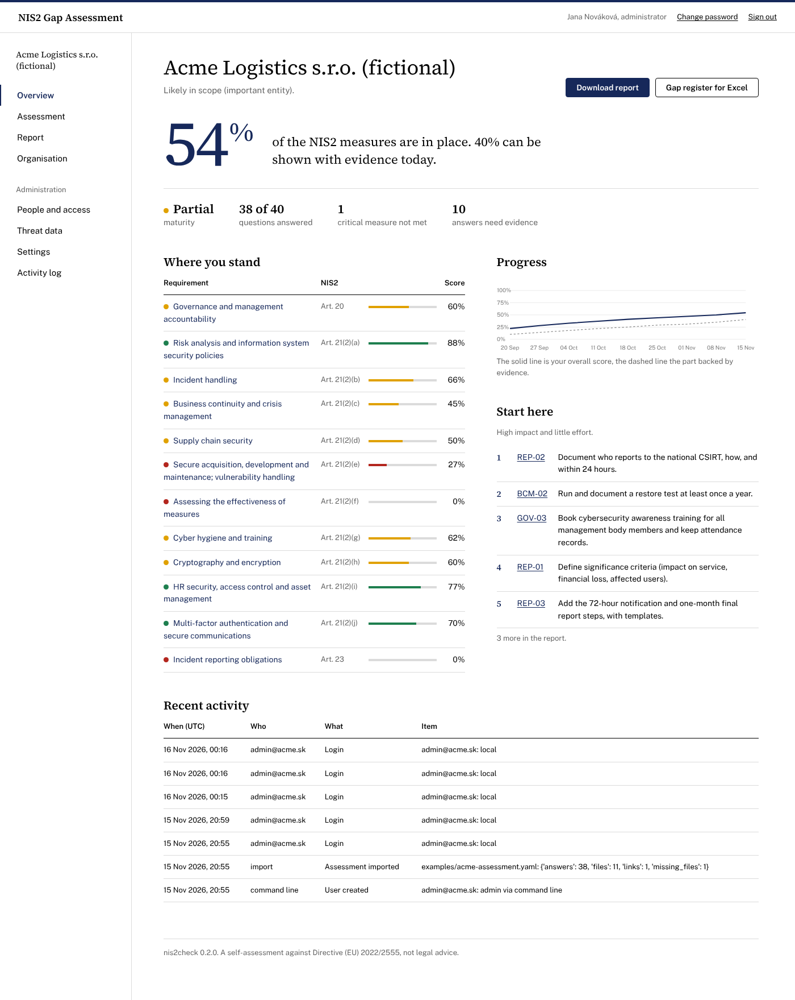

<picture>
  <source media="(prefers-color-scheme: dark)" srcset="docs/brand/banner-dark.svg">
  
</picture>

**Self-hosted NIS2 gap assessment for the whole team: questionnaire, evidence, threat-informed priorities and audit-ready reports.**

> **Disclaimer.** nis2check gives an *indicative* self-assessment to help you find and
> prioritise gaps. It is not legal advice, not an official audit, and not a certification
> of compliance. NIS2 is implemented through national transposition laws, and the final
> say on scope and obligations rests with your competent authority and your own legal
> and security advisers. Use the output as a starting point, not as proof of compliance.

NIS2 (Directive (EU) 2022/2555) requires medium and large organisations in critical sectors to put cybersecurity risk-management measures in place, have management approve them, and report significant incidents within 24 hours. Commercial compliance platforms are priced for larger companies, and spreadsheets do not hold evidence or history. `nis2check` runs on your own server, keeps your data in-house, and answers four questions:

1. **Are we likely in scope?** An indicative check based on company size and the Annex I and II sectors.
2. **Where are our gaps?** 40 practical questions mapped to Articles 20, 21(2)(a) to (j) and 23.
3. **Can we prove it?** Evidence files and links per question, with expiry dates. A second, evidence-backed score counts only answers with valid evidence.
4. **What should we fix first?** Priorities informed by open threat data (VERIS Community Database, MITRE ATT&CK, CISA KEV, ENISA EUVD) and an impact vs effort matrix.



## Features

- **Web app, no technical skills needed.** Point-and-click questionnaire, one requirement per page, answers saved per question.
- **Roles.** Administrators manage users and settings, assessors answer and upload evidence, viewers (for example management) read the dashboard and download reports.
- **Single sign-on** with Microsoft Entra ID or Google Workspace, plus local accounts.
- **Evidence register.** Upload files or link to SharePoint, Drive or a wiki; set "valid until" dates for things like yearly restore tests. Expired evidence is flagged automatically.
- **Dashboard** with RAG status per requirement, progress over time and quick wins.
- **Audit-style report** as PDF, HTML, CSV gap register (opens in Excel) or JSON.
- **Threat data updates with approval.** The app checks the public sources weekly; an administrator reviews a change report and approves or rejects it before any weight changes.
- **Audit log** of every sign-in, answer, upload, download and setting change.
- **Your data stays with you.** Everything lives in one Docker volume on your server.

## Install

You need a server or VM with [Docker](https://docs.docker.com/engine/install/). Then:

```bash
git clone https://github.com/finsecguy/nis2check.git
cd nis2check
docker compose up -d
```

Open `http://<your-server>:8080`. The first visit asks you to create the administrator account. That is all that is required; everything else is optional.

### Recommended for production

1. Put the app behind HTTPS (your existing reverse proxy, load balancer or a tool such as Caddy).
2. Copy `.env.example` to `.env` and set:
   - `NIS2_BASE_URL=https://nis2.yourcompany.com`
   - `NIS2_SECURE_COOKIES=true`
   - `NIS2_BEHIND_PROXY=true` (only if a reverse proxy sits in front of the app)
3. Restart: `docker compose up -d`.
4. Set up backups (below).

## Single sign-on

### Microsoft Entra ID

1. In the Entra admin centre, open **App registrations > New registration**.
2. Name it "NIS2 Gap Assessment", choose **Accounts in this organizational directory only**, and add a **Web** redirect URI: `https://nis2.yourcompany.com/sso/entra/callback`.
3. Under **Certificates & secrets**, create a client secret.
4. Under **Token configuration > Add optional claim > ID**, add the `xms_edov` claim. Entra does not verify the `email` claim by default, so without `xms_edov` the app cannot confirm an address belongs to the person signing in, and will refuse to link it to an admin-created account (see "Who can sign in" below).
5. In `.env`, set `NIS2_ENTRA_TENANT_ID`, `NIS2_ENTRA_CLIENT_ID` and `NIS2_ENTRA_CLIENT_SECRET`, then restart.

### Google Workspace

1. In Google Cloud Console, open **APIs & Services > Credentials > Create credentials > OAuth client ID** (type: Web application).
2. Add the redirect URI `https://nis2.yourcompany.com/sso/google/callback`.
3. In `.env`, set `NIS2_GOOGLE_CLIENT_ID` and `NIS2_GOOGLE_CLIENT_SECRET`, then restart.

### Who can sign in

By default, only people an administrator has added under **Users** can sign in with SSO; their account is linked to their SSO identity at first sign-in, provided the identity provider has verified the email address. Google always does this; for Entra ID, add the `xms_edov` optional ID-token claim (see step 4 above), or first sign-ins cannot be linked to the pre-created account. To let everyone in your company in automatically, set `NIS2_SSO_ALLOWED_DOMAINS=yourcompany.com` and `NIS2_SSO_AUTO_PROVISION=true`; new accounts get the viewer role (or `NIS2_SSO_DEFAULT_ROLE=assessor`) and never the administrator role. Once SSO works, you can turn off password sign-in with `NIS2_LOCAL_LOGIN=false`.

## Backups and upgrades

All data (database, evidence files and the session key) lives in the `nis2check-data` volume.

```bash
# back up
docker run --rm -v nis2check_nis2check-data:/data -v "$PWD":/backup alpine \
  tar czf /backup/nis2check-backup-$(date +%F).tgz -C /data .

# upgrade to a new version
git pull && docker compose up -d --build
```

## Moving an existing assessment into the app

If you started with the command-line version (a YAML file), import it with its evidence files:

```bash
docker cp my-assessment/ nis2check:/tmp/import
docker exec nis2check nis2check web import /tmp/import/assessment.yaml
```

## How priorities are calculated

### Scoring

- Each control has a weight: its **regulatory baseline** from the NIS2 priority (critical 3, high 2, medium 1), raised by threat data as described below.
- Yes = 1, partially = 0.5, no = 0, not assessed = 0; not applicable is excluded.
- The **overall score** is the weighted average of the applicable controls. The **evidence-backed score** counts an answer only if it has valid evidence: an existing file, a link, and not past its "valid until" date.
- Open items are ranked by **risk reduction**, `weight x (1 - score)`, or, if you choose in Settings, by risk reduction per unit of effort.

### Threat-informed weighting

The baseline is raised by up to 50% for controls that counter threats seen often in real incidents:

```
exposure   = sum of the prevalence of the threat patterns a control counters
multiplier = 1 + 0.5 x exposure / highest exposure of any control
weight     = baseline x multiplier
```

Threat data can raise a weight but never lower it, because every NIS2 control is a legal requirement however rare the threat it addresses. Every weight is explained in the app, the report (Appendix C) and the CSV, for example:

> Baseline 3 x 1.15 = 3.46. Counters: Stolen or brute-forced credentials 17% of incidents (ATT&CK M1032).

| Input | Source | Used for |
|---|---|---|
| Prevalence of 9 threat patterns | [VERIS Community Database](https://github.com/vz-risk/VCDB) | How common each threat is |
| Mitigation to technique links | [MITRE ATT&CK](https://github.com/mitre-attack/attack-stix-data) (STIX 2.1) | Which controls counter which threats |
| Newly exploited vulnerabilities, year on year | [CISA KEV](https://www.cisa.gov/known-exploited-vulnerabilities-catalog) and [ENISA EUVD](https://euvd.enisa.europa.eu/) | Trend adjustment for vulnerability exploitation (0.8 to 1.25) |

Data handling choices:

- **Campaigns are counted once.** Mass campaigns are recorded in VCDB once per victim; MOVEit in 2023 alone produced 747 identical records. Records sharing a campaign ID, or five or more records in the same year with the same summary, count as one event.
- **Minimum sample.** The VCDB window (default 5 years) widens until it holds at least 300 events.
- **Caveats.** VCDB covers publicly reported incidents, mostly in the United States, and is not the full Verizon DBIR dataset. CISA KEV is US-centric; ENISA EUVD adds an EU view. These caveats are printed in every report.

### Threat data updates

The app checks the four sources weekly (or on demand under **Threat data**) and stores the result as a pending update with a change report: every pattern and weight that moved, with large moves flagged. Nothing changes until an administrator approves it. If CISA KEV or ENISA EUVD is unavailable the check continues without the trend adjustment; if VCDB or ATT&CK is unavailable nothing changes. For servers without internet access, copy the source files into a folder and set `NIS2_THREAT_SOURCE_DIR`.

### Effort and quick wins

Each control has an effort estimate (low, medium, high) for an SME. Open items are placed on an impact vs effort matrix: quick wins, major projects, fill-ins and items to schedule later.

## The report

The report follows the structure of an internal-audit gap assessment and prints cleanly to A4.

| Section | Content |
|---|---|
| Document control | Organisation, date, preparer, framework, weighting, classification |
| 1. Executive summary | Generated narrative plus key figures and quick wins |
| 2. Scope and applicability | Enterprise size, Annex I or II sector, likely classification |
| 3. Compliance overview | RAG status per requirement, priority x status heat map, impact vs effort matrix |
| 4. Remediation plan | Highest-priority open items with effort, recommended action, owner and target columns |
| 5. Evidence review | Controls claimed as met without valid evidence |
| Appendix A, B, C | Full control results, methodology, threat data sources and weight rationale |

## Coverage

| Domain | NIS2 reference | Topic |
|---|---|---|
| GOV | Art. 20 | Management approval, oversight and training |
| RISK | Art. 21(2)(a) | Risk analysis and information security policies |
| INC | Art. 21(2)(b) | Incident handling |
| BCM | Art. 21(2)(c) | Backups, disaster recovery, crisis management |
| SUP | Art. 21(2)(d) | Supply chain security |
| SDLC | Art. 21(2)(e) | Secure acquisition and development, vulnerability handling |
| EFF | Art. 21(2)(f) | Assessing the effectiveness of measures |
| HYG | Art. 21(2)(g) | Cyber hygiene and training |
| CRY | Art. 21(2)(h) | Cryptography and encryption |
| ACC | Art. 21(2)(i) | HR security, access control, asset management |
| MFA | Art. 21(2)(j) | Multi-factor authentication, secure communications |
| REP | Art. 23 | 24-hour early warning, 72-hour notification, final report |

The control catalogue ([`nis2check/data/controls.yaml`](nis2check/data/controls.yaml)) and threat pattern taxonomy ([`nis2check/data/patterns.yaml`](nis2check/data/patterns.yaml)) are plain files you can review and adapt, for example to add national requirements.

## Security

- Passwords are hashed with scrypt; sign-in is rate-limited per address and per account.
- SSO uses OpenID Connect with state, nonce and ID-token signature checks; SSO accounts are bound to one identity.
- Every form is protected against cross-site request forgery; pages send a strict Content Security Policy.
- Evidence files are stored under random names, type-checked on upload and always downloaded as attachments.
- The container runs as an unprivileged user. Found a problem? Please open a private security advisory on GitHub.

## Command-line use

The same engine runs without the web app, for automation or CI:

```bash
pip install ".[pdf]"
nis2check init --name "Your Company s.r.o."            # creates assessment.yaml
nis2check report assessment.yaml --pdf report.pdf --csv gap-register.csv
nis2check report assessment.yaml --fail-under 70 --evidence-backed   # exit code 2 below threshold
nis2check update-threat-data --change-report change.md   # refresh the bundled threat data
```

Run `nis2check --help` for all commands. The bundled threat data snapshot is refreshed by the weekly [`update-threat-data`](.github/workflows/update-threat-data.yml) workflow, which opens a pull request for review.

## Development

```bash
pip install -e ".[dev,web]"
pytest
nis2check web serve --data-dir ./data      # development server on http://127.0.0.1:8080
```

## Limitations

- This is a self-assessment aid, not a certification or legal advice.
- Threat weights reflect public incident data, which over-represents incidents that become news and US organisations. Effort ratings are estimates.
- The scope check covers the size-cap rule and Annex I and II sectors only. National transposition laws, designations by the competent authority and sector-specific rules (such as DORA for financial entities) can change the outcome.
- Questions reflect the directive text. Implementing acts and national guidance may set more detailed requirements for some entity types.

## License

MIT
