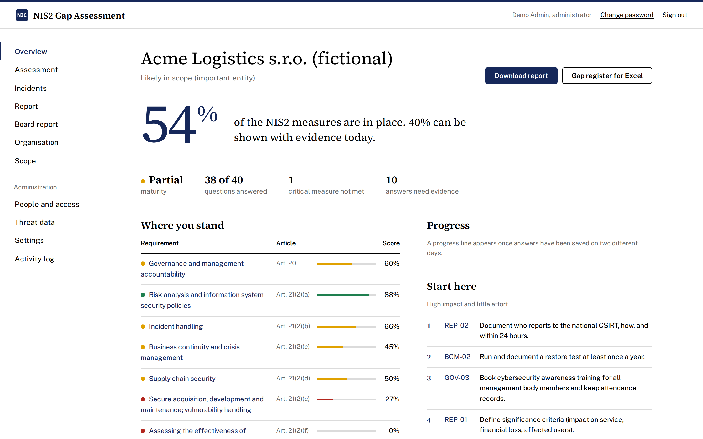
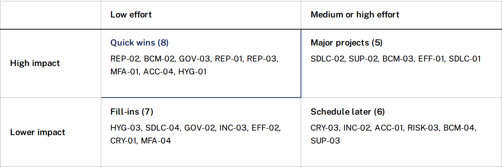
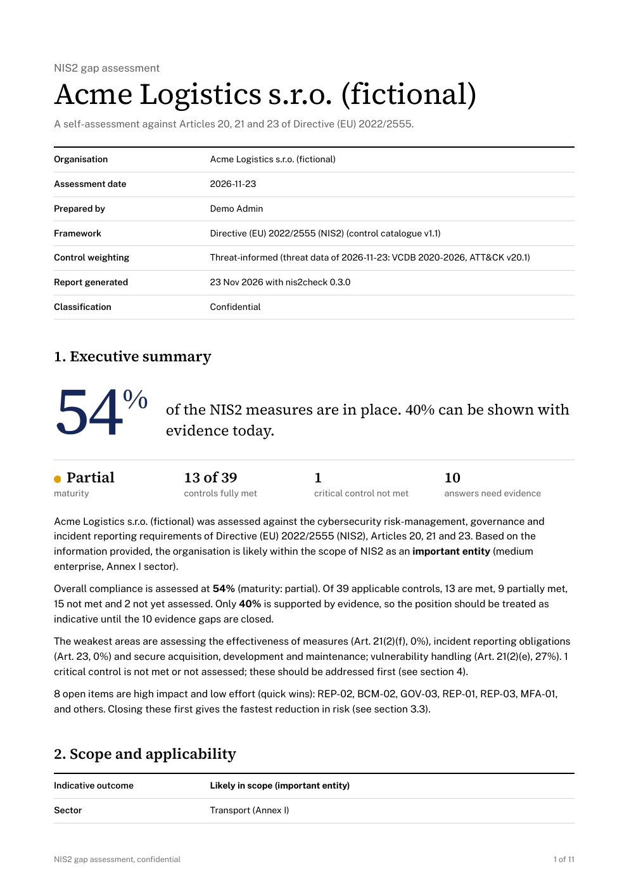

<picture>
  <source media="(prefers-color-scheme: dark)" srcset="docs/brand/banner-dark.svg">
  
</picture>

**Self-hosted NIS2 and DORA gap assessment: questionnaire, evidence, threat-informed priorities and reports.**

> **Disclaimer.** nis2check is an indicative self-assessment. It is not legal advice, not an official audit, and not a certification. NIS2 is applied through national law. DORA applies to financial entities as a regulation. Your competent authority and your own advisers decide scope and duties. nis2check supports a self-assessment and does not replace a certified auditor. National citations must be checked against the official text.

NIS2 (Directive (EU) 2022/2555) asks in-scope organisations to manage cybersecurity risk, have management approve the measures, and report significant incidents. DORA (Regulation (EU) 2022/2554) sets digital resilience duties for financial entities. Where DORA covers ICT risk and incident reporting, it is lex specialis to NIS2. `nis2check` runs on your own server.

1. **Are we likely in scope?** Size and Annex I and II sectors. Indicative only.
2. **Where are our gaps?** 40 NIS2 questions (Articles 20, 21(2)(a) to (j) and 23) and 27 DORA questions (Articles 5 to 45).
3. **Can we prove it?** Evidence files and links, with expiry dates. A second score counts only valid evidence.
4. **What should we fix first?** Threat-informed weights and an impact versus effort matrix.



The overview shows the score, status by requirement, and the first quick wins.



Open items fall into quick wins, major projects, fill-ins, and items to schedule later.



Page 1 of the PDF names the organisation, the score, and the indicative scope result.

## Features

- Web questionnaire, one requirement per page. Roles: administrator, assessor, viewer.
- Local accounts, or single sign-on with Microsoft Entra ID or Google Workspace.
- Evidence files or links, with a "valid until" date. Expired evidence is flagged.
- Reports as PDF, HTML, CSV, JSON, or a CISO Assistant import.
- Threat data updates wait for an administrator to approve them.
- Audit log of sign-ins, answers, uploads, downloads and setting changes.
- Optional country overlay for Slovakia, Czechia, Hungary and Poland. EU keeps the Directive text only.

## Install

You need [Docker](https://docs.docker.com/engine/install/).

```bash
git clone https://github.com/finsecguy/nis2check.git
cd nis2check
docker compose up -d
```

Open `http://<your-server>:8080` and create the administrator account. For production, put the app behind HTTPS, copy `.env.example` to `.env`, and set `NIS2_BASE_URL`, `NIS2_SECURE_COOKIES=true`, and `NIS2_BEHIND_PROXY=true` if a proxy sits in front.

SSO setup (Entra ID or Google) is in `.env.example`. By default only people an administrator has added can sign in. Set `NIS2_SSO_ALLOWED_DOMAINS` and `NIS2_SSO_AUTO_PROVISION=true` to create viewer accounts on first sign-in.

## Backups

All data lives in the `nis2check-data` volume: SQLite database, evidence files and the session key.

```bash
docker run --rm -v nis2check_nis2check-data:/data -v "$PWD":/backup alpine \
  tar czf /backup/nis2check-backup-$(date +%F).tgz -C /data .
```

Upgrade with `git pull && docker compose up -d --build`.

Import a command-line YAML assessment:

```bash
docker cp my-assessment/ nis2check:/tmp/import
docker exec nis2check nis2check web import /tmp/import/assessment.yaml
```

## How priorities are calculated

Yes = 1, partial = 0.5, no = 0, not assessed = 0. Not applicable is left out. The score is the weighted average. The evidence-backed score counts an answer only when its evidence exists and is not past its date.

Each control starts at a baseline: critical 3, high 2, medium 1. Threat data can raise that by up to 50 percent. It never lowers a weight.

```
exposure   = sum of the prevalence of the threat patterns a control counters
multiplier = 1 + 0.5 x exposure / highest exposure of any control
weight     = baseline x multiplier
```

Prevalence comes from the [VERIS Community Database](https://github.com/vz-risk/VCDB). Links to controls come from [MITRE ATT&CK](https://github.com/mitre-attack/attack-stix-data). [CISA KEV](https://www.cisa.gov/known-exploited-vulnerabilities-catalog) and [ENISA EUVD](https://euvd.enisa.europa.eu/) adjust the vulnerability pattern between 0.8 and 1.25. Mass campaigns count once. The VCDB window widens until it holds at least 300 events. These sources are public incident data, mostly from the United States. They are not the full Verizon DBIR set.

The app checks the four sources weekly, or on demand under **Threat data**. An administrator approves or rejects the change before any weight moves. Set `NIS2_THREAT_SOURCE_DIR` to read files from disk instead.

Effort is low, medium or high. Open items sit on an impact versus effort matrix.

## The report

The PDF is an internal gap assessment and prints to A4.

| Section | Content |
|---|---|
| Document control | Organisation, date, preparer, framework, weighting |
| 1. Executive summary | Score, evidence score, quick wins |
| 2. Scope | Size, sector, indicative classification |
| 3. Overview | Status by requirement, and the impact versus effort matrix |
| 4. Remediation | Open items, with effort, action, owner and target |
| 5. Evidence | Answers marked met without valid evidence |
| Appendix | Every control, the method, and the weight rationale |

## Coverage

NIS2 domains: governance (Art. 20), risk policy (Art. 21(2)(a)), incident handling (b), continuity (c), supply chain (d), secure development (e), effectiveness (f), hygiene and training (g), cryptography (h), access and assets (i), multi-factor authentication (j), and incident reporting (Art. 23).

DORA pillars: ICT risk (Art. 5-16), incidents (Art. 17-23), resilience testing (Art. 24-27), third parties (Art. 28-44), and information sharing (Art. 45). The question text is original. The article number says which duty it is about.

## Country support

Set the country on the organisation page, or pass `--country sk|cz|hu|pl` to `init`, `interview`, `report` and `controls`. `eu` leaves the Directive text unchanged. The screen language follows the country unless a user picks another one.

Each finding shows the Directive article and the national provision. A citation that was not read in the official consolidated text is marked **unverified**. Hungary and Poland are unverified on purpose. Slovakia can download a working self-assessment for an NBU filing. It is not an official form.

Add a country by writing `nis2check/data/jurisdictions/<code>.yaml`. The schema is in `docs/jurisdictions/README.md`. Set `verified: true` only after you have read the paragraph and its title in the official text.

## Command line

```bash
pip install ".[pdf]"
nis2check init --name "Your Company s.r.o."
nis2check report assessment.yaml --pdf report.pdf --csv gap-register.csv
nis2check report assessment.yaml --ciso ciso-assistant.zip
```

The CISO Assistant zip holds a library YAML and a compliance-assessment CSV per framework. It fills nis2check's own question set. It does not fill CISO Assistant's own DORA library, which uses different ids.

## Security

Passwords are hashed with scrypt, and sign-in is rate-limited. SSO uses OpenID Connect with state, nonce and ID-token checks. Forms use a CSRF token. Evidence files are stored under random names and downloaded as attachments. The container runs as an unprivileged user. Report a problem through a private security advisory on GitHub.

## Limitations

The scope check covers the NIS2 size rule and Annex I and II sectors. It does not decide whether DORA applies. National law, a designation by the competent authority, and the financial-entity list in DORA Article 2 can change the result. The DORA questions cover the five pillars. They are not the full text of the regulatory technical standards. Threat weights come from public incident data, which over-represents incidents that become news and organisations in the United States. Effort ratings are estimates.

## Your data

The app does not send telemetry. Answers, evidence and reports stay in your database. Outbound calls are limited to two cases. Threat updates download public files from VCDB, ATT&CK, CISA KEV and ENISA EUVD. Nothing is uploaded. Sign-in talks to Microsoft or Google only if you configure them.

The database is SQLite. In Docker it is `/data/nis2check.db` in the `nis2check-data` volume, next to `evidence/` and `.secret_key`. A development server uses `./data` or `NIS2_DATA_DIR`. Back up by copying that directory. To delete everything, stop the app and run `docker volume rm nis2check_nis2check-data`, or delete the data directory.

## License

MIT
